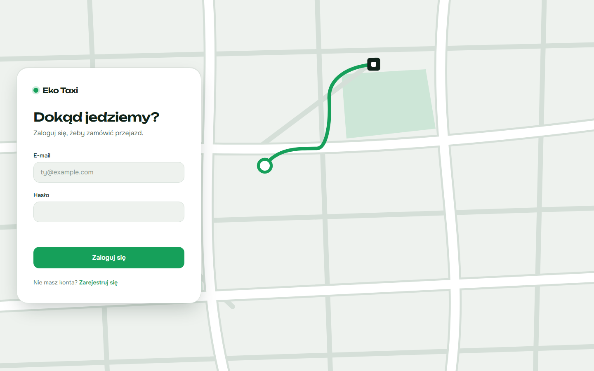
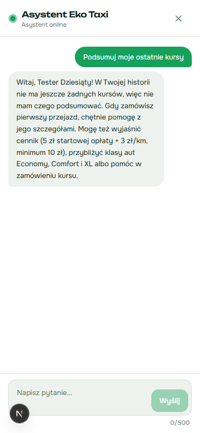

# Eko Taxi

Aplikacja do zamawiania przejazdów w stylu Bolta/Ubera: mapa, wycena, symulowani kierowcy,
historia kursów, promocje, powiadomienia na Discordzie i czatbot oparty na Claude Code.

**Aplikacja:** _link do Vercela — uzupełniany po wdrożeniu_

| Logowanie | Czatbot |
| --- | --- |
|  |  |

## Technologie

- **Next.js 16** (App Router, Route Handlers, `proxy.ts`) + TypeScript + Tailwind CSS
- **Supabase**: Postgres, Auth, Row Level Security, Realtime
- **Leaflet** + OpenStreetMap, wyszukiwanie adresów przez Nominatim
- **Discord webhooks**: powiadomienia o statusie kursu i promocjach
- **Claude Code CLI w trybie headless** (`claude -p`): czatbot obsługiwany przez lokalny worker
- **Vitest**: testy jednostkowe, **Vercel**: hosting

## Wymagania zaliczenia → gdzie są w kodzie

| Wymaganie | Funkcja | Pliki |
| --- | --- | --- |
| Logowanie | rejestracja i logowanie e-mailem, ochrona stron | `app/(auth)/`, `lib/auth.ts`, `proxy.ts` |
| Preferencje użytkownika | motyw jasny/ciemny, domyślna klasa auta, imię, powiadomienia | `app/settings/`, `components/ThemeSync.tsx`, `lib/profile.ts` |
| Odczyt/zapis w bazie | kursy, profile, promocje, wiadomości czatu (z RLS) | `supabase/migrations/`, `app/api/rides/`, `lib/rides-service.ts` |
| Powiadomienia | Discord: zmiany statusu kursu i nowe promocje | `lib/discord.ts`, `app/api/promos/route.ts` |
| Czatbot (Claude Code headless) | panel czatu + worker uruchamiający `claude -p` | `components/chat/`, `worker/` |
| Wdrożenie na Vercel | produkcyjny build z gałęzi `main` | — |
| Repozytorium GitHub | https://github.com/mateo2021/EKOTaxi | — |

## Uruchomienie lokalne

1. `npm install`
2. Skopiuj `.env.example` do `.env.local` i uzupełnij:
   - `NEXT_PUBLIC_SUPABASE_URL`, `NEXT_PUBLIC_SUPABASE_ANON_KEY`, `SUPABASE_SERVICE_ROLE_KEY` (Supabase → Project Settings → API)
   - `DISCORD_WEBHOOK_URL`: opcjonalny; bez niego aplikacja działa, tylko nie wysyła powiadomień
3. Uruchom migracje z `supabase/migrations/` po kolei (SQL Editor w Supabase).
4. `npm run dev` uruchamia serwer developerski, a `npm test` testy.

## Czatbot: worker

Czat zapisuje pytanie w tabeli `chat_messages` (status `pending`). Worker na komputerze
właściciela nasłuchuje przez Supabase Realtime, wywołuje `claude -p` i zapisuje odpowiedź.
Panel czatu pokazuje, czy asystent jest online (heartbeat workera).

1. Zainstaluj Claude Code i zaloguj się (`claude`, potem `/login`).
2. Skopiuj `worker/.env.example` do `worker/.env` i uzupełnij `SUPABASE_URL` oraz `SUPABASE_SERVICE_ROLE_KEY`.
3. `npm run worker`, a zatrzymanie przez Ctrl+C.

Zabezpieczenia: Claude działa bez narzędzi, MCP, ustawień i hooków użytkownika, z własnym
promptem systemowym, w pustym katalogu tymczasowym. Pytanie trafia tylko przez stdin.
Użytkownik może mieć jedno oczekujące pytanie (RLS), a limit wynosi 20 pytań na godzinę.

## Scenariusz demo

1. Zarejestruj konto i zaloguj się.
2. W **Ustawieniach** zmień motyw i domyślną klasę auta, włącz powiadomienia.
3. Na mapie wybierz skąd i dokąd, zobacz cenę, zamów kurs. Status zmienia się
   (szukanie → kierowca jedzie → w trakcie → zakończony), a na Discord przychodzą powiadomienia.
4. Zobacz kurs w **Historii**.
5. Otwórz czat i zapytaj np. „Ile zapłacę za 10 km Comfortem?” (worker musi działać).
6. Jako admin (`profiles.is_admin = true`) dodaj promocję w **Promocjach**, a ona trafi na Discord.
